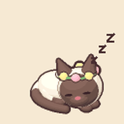
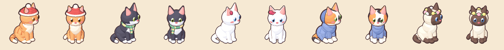

# Study Cat 🐱

A cozy Pomodoro study timer with a cat who keeps you company. While you study, the cat sits at its desk and reads, turning a page now and then. On your break it hops down to the rug and wants to play, eat or have a bath. Switch tabs during study and it gets sad.

**Live:** https://study-cat-pink.vercel.app

<p align="center">
  
  
  
</p>

<p align="center">
  
</p>

## Features

- Study / break timer (50 / 10 minutes by default, adjustable), with today's study minutes saved in the browser
- An animated cat that walks to the desk, reads, takes breaks, naps when you're idle, and meows when you click it
- **My Cat** wardrobe: 5 breeds and 5 outfits
- Optional accounts (Supabase magic link): earn coins for studying and keep a daily streak
- The cat speaks short lines with the browser's built-in speech (you can mute it)
- A cozy room with lighting that changes between study and break

## Tech stack

- [React 19](https://react.dev) + [Vite](https://vite.dev): the app, timer and panels
- [Phaser 3](https://phaser.io): the room and the cat (sprite animations, camera)
- A small state machine (`src/game/catBrain.js`) that only moves the cat through its animation chains, so it never snaps between poses
- [Supabase](https://supabase.com) for login and the database. Coins and streaks are counted on the server (Postgres functions + Row Level Security), so they can't be faked from the browser.
- Web Speech API for the cat's voice, `localStorage` for saved settings
- Hosted on [Vercel](https://vercel.com)

## Run it locally

You need [Node.js](https://nodejs.org) 20.19+ or 22.12+ (what Vite 8 requires).

```bash
git clone https://github.com/hritesh94/study-cat.git
cd study-cat
npm install
npm run dev
```

Then open http://localhost:5173. Add `?debug` to the address for the cat debug panel (every animation, breed and outfit, plus slow motion).

Accounts are optional. To try them, copy `.env.example` to `.env.local` and fill in your Supabase project's URL and **publishable** key, then paste the three files in `supabase/migrations/` into Supabase's SQL Editor, in order.

| Command | What it does |
|---|---|
| `npm run dev` | Start the dev server |
| `npm run build` | Build the site into `dist/` |
| `npm run lint` | Check the code |
| `npm run thumbs` | Re-cut the wardrobe pictures after changing the sprite sheets |
| `npm run test:db` | Test the database migrations locally |

## How it was built

[PROJECT_LOG.md](PROJECT_LOG.md) walks through every step, from the first timer to accounts and coins, with plain-language explanations.

The cat sprites were made for this project by the generator in `tools/cat-generator-hd/` (Python; see its README).
